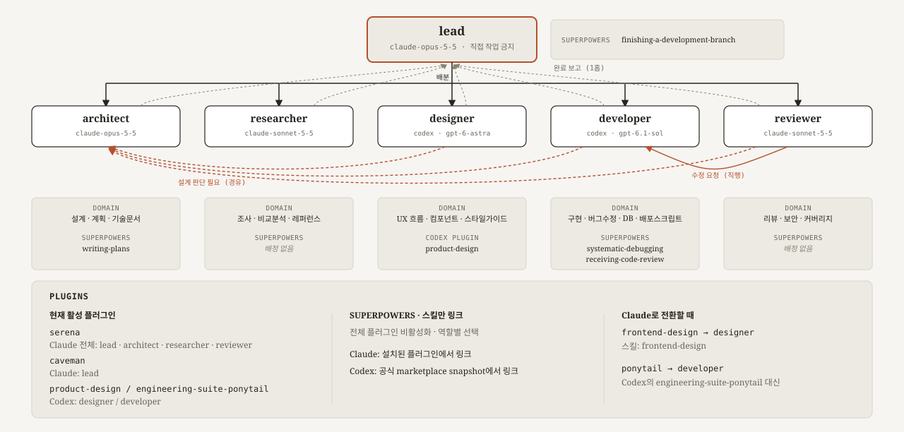

# My AI team

- Claude Code와 Codex를 역할별로 골라 tmux 파인에 띄우는 멀티에이전트 오케스트레이션 셋업
- 구성: `team/config.sh`의 `MEMBERS`에 선언한 역할 × 에이전트(Claude/Codex)로 만드는 팀
  (기본값은 lead·architect·researcher·designer·developer·reviewer 6인, 불필요한 역할은 `MEMBERS`에서 뺀다)
- 한 팀에 두 공급자를 섞을 수 있다 — 공급자별 차이는 아래 "에이전트 공급자별 차이" 참고

## 구조



| 역할       | 담당                                                      |
| ---------- | --------------------------------------------------------- |
| lead       | 배분·수합·git 커밋 (직접 작업하지 않음)                   |
| architect  | 설계·기술 판단, 설계 이탈 승인                            |
| researcher | 웹 조사                                                   |
| designer   | UI/UX 설계 + **프론트엔드 구현** (마크업·스타일·컴포넌트) |
| developer  | **백엔드 구현** (API·DB·테스트·빌드)                      |
| reviewer   | 코드 리뷰·QA·커버리지 판정                                |

designer와 developer는 프론트/백엔드로 갈린다 — designer가 화면을 설계하고 그대로 구현하며,
필요한 API는 `say developer`로 요청한다. 상세는 각 `team/{역할}.md` 참조.

```
CLAUDE.md               Claude 파인 공통 규칙
AGENTS.md               Codex 파인 공통 규칙
team/                   프로젝트별 오버라이드 대상만 (역할 지침·공급자별 설정)
  ├ config.sh           팀 공통 구성 템플릿 (역할·표시명·공급자·모델·추론 수준)
  ├ config.claude.sh    Claude 역할별 플러그인·스킬 배분표
  ├ config.codex.sh     Codex 역할별 플러그인·스킬 배분표
  └ {역할}.md             역할별 지침 (lead/architect/researcher/designer/developer/reviewer)
bin/                    항상 이 저장소 기준으로 고정 실행되는 스크립트 (오버라이드 대상 아님)
  ├ say                 파인 간 메시지 전송 래퍼 (setup-team.sh가 각 파인 PATH에 등록)
  └ log-hook            프롬프트·툴 사용을 .team-logs/{역할}.jsonl에 기록하는 훅
docs/                   설계 배경·실측 분석 문서
  └ architect-review/   architect의 리뷰 판정 문서 ({순번}_{주제}.md)
Dockerfile              팀 환경용 컨테이너 이미지 정의 (격리 실행할 때)
setup-docker.sh         Docker로 이미지 빌드 + 컨테이너 기동 + setup-team.sh 실행
setup-native.sh         WSL 등 호스트에 직접 의존성 설치 (Docker 없이 실행할 때)
setup-team.sh           tmux 세션 구성 + 선택한 에이전트 CLI 실행 (핵심 스크립트)
```

## 실행 방식 및 사용법

|               | WSL 네이티브                        | Docker                                            |
| ------------- | ----------------------------------- | ------------------------------------------------- |
| 격리          | 없음 (호스트에 직접 설치)           | 컨테이너로 격리                                   |
| 적합한 경우   | 혼자 개발, 빠른 반복                | 팀 배포, 환경 재현성 필요                         |
| 진입 스크립트 | `setup-native.sh` → `setup-team.sh` | `setup-docker.sh` (내부에서 `setup-team.sh` 실행) |

### 진입

먼저 이 저장소를 clone(아래 예시는 `~/ai-setup` 기준).

```bash
git clone https://github.com/khangte/my-ai-team.git ~/ai-setup
```

#### WSL 네이티브

```bash
# ai-setup/ 안에서 실행
./setup-native.sh /path/to/project     # 최초 1회: 팀에 쓰이는 공급자 의존성을 모두 설치
./setup-team.sh /path/to/project        # 지정한 프로젝트로 팀 세션 실행

# Codex 팀
./setup-native.sh --agent codex          # 최초 1회: tmux/codex 의존성 설치
./setup-team.sh --agent codex /path/to/project

# 작업 디렉터리(프로젝트 루트)에서 실행
~/ai-setup/setup-native.sh              # 최초 1회
~/ai-setup/setup-team.sh .              # 현재 디렉터리를 프로젝트로 지정

# Codex 팀
~/ai-setup/setup-native.sh --agent codex
~/ai-setup/setup-team.sh --agent codex .
```

#### Docker

```bash
# ai-setup/ 안에서 실행
./setup-docker.sh /path/to/project      # 이미지 빌드 + 컨테이너 기동 + setup-team.sh 실행

# 작업 디렉터리(프로젝트 루트)에서 실행
~/ai-setup/setup-docker.sh .            # 현재 디렉터리를 프로젝트로 지정
```

> `setup-team.sh` 인자 규칙
>
> - 인자 생략 시 환경변수 `$PROJECT_DIR`, 그것도 없으면 **현재 디렉터리** 사용
> - 상대·절대 경로 모두 허용
> - 세션 이름 기본값은 `team1`, `team/config.sh`의 `SESSION=` 값으로 변경 가능
>   (아래 "프로젝트별 팀 구성 커스터마이징" 참고)

### setup-team.sh 실행되면

0. 의존성·인증 확인 `[0/7]` (공통)
   - tmux 설치 여부는 항상 확인
   - 실제로 팀에 쓰이는 공급자마다 필요한 도구·인증을 확인 (혼합 팀이면 둘 다)
     - Claude: claude/rtk/bun 설치, `claude auth status` 로그인 확인 (미로그인 시 `/login` 안내 후 대기)
     - Codex: codex 설치, `codex login status` 로그인 확인 (미로그인 시 `codex login` 안내 후 대기)
   - 확인 직후 기존 tmux 세션을 정리 (`.team/` 삭제와의 경합 방지)
1. 공급자별 준비 — 팀에 쓰이는 공급자만 실행, 혼합 팀이면 Claude 블록 뒤에 Codex 블록
   - Claude 파인이 있을 때 `[1/7]`~`[4/7]`
     - rtk 훅 초기화, gstack 스킬(`/office-hours`, `/review` 등) 설치
     - 필수 마켓플레이스 플러그인(superpowers/frontend-design/serena/ponytail/caveman) 설치 — 역할별 활성화는 파인 실행 단계가 담당
     - 팀 공통 지침을 `CLAUDE.md`에 병합 + 역할별 스킬 제한 — `.team/{역할}/.claude/skills`에 그 역할이 쓸 스킬만 링크
   - Codex 파인이 있을 때 `[5/7]`
     - `AGENTS.md` 병합, 역할별 스킬·플러그인·lifecycle 훅 준비
2. tmux 세션 구성 `[6/7]` (공통)
   - 팀 인원 수만큼 파인 분할
   - 파인 타이틀은 대문자로 표시 (예: `LEAD`, `ARCHITECT`)
3. 각 파인에서 `MEMBERS`가 지정한 CLI 실행 `[7/7]` (공통) — 실행 로그에 파인별 model·effort 표시
   - Claude: 지정 모델, 역할 지침·훅 설정·플러그인 활성화를 주입한 `claude --dangerously-skip-permissions`
   - Codex: 역할별 `AGENTS.md`를 읽고 Git 메타데이터까지 쓸 수 있는
     `codex --dangerously-bypass-approvals-and-sandbox`
     - 읽기·코드 수정만 허용하려면 `CODEX_FULL_ACCESS=0`으로 실행
       (`workspace-write`는 `.git`을 항상 read-only로 보호하므로 `git add/commit`은 불가)
4. 완료 후 `tmux attach -t [세션명]` 접속 안내

### 세션 확인 및 종료

```bash
# team1: 세션명 예시
tmux attach -t team1                          # 접속 (WSL 네이티브)
docker exec -it claude-env bash -lc "tmux attach -t team1"   # 접속 (Docker — 컨테이너 재진입 후 attach)
tmux capture-pane -t team1:0.N -p | tail -5   # N번 파인 진행 상황만 확인
tmux kill-session -t team1                    # 세션 종료
```

### 권한 우회 플래그를 쓰는 이유

- 두 공급자 모두 권한 우회 플래그로 실행됨(Claude `--dangerously-skip-permissions`, Codex `--dangerously-bypass-approvals-and-sandbox`) — 툴 사용마다 사람 승인이 필요하면 멀티에이전트 자동 진행이 불가능해서
- 대가: 파인이 확인 없이 파일을 수정·삭제 → **git으로 관리되는 프로젝트**에서 쓰거나 Docker로 격리 권장

### 에이전트 공급자별 차이

`MEMBERS`의 `agent` 열(`claude`/`codex`)로 역할마다 공급자를 고른다. 규칙은 "프로젝트별 팀 구성 커스터마이징" 참고.

| 항목              | Claude Code                                              | Codex                                                       |
| ----------------- | -------------------------------------------------------- | ----------------------------------------------------------- |
| 지침 로딩         | 공통 규칙은 `CLAUDE.md`에 병합, 역할 지침은 `--append-system-prompt` | 공통 규칙은 `AGENTS.md`에 병합, 역할 지침은 `.team/{역할}/AGENTS.md` |
| 스킬·플러그인 배분 | `team/config.claude.sh`                                  | `team/config.codex.sh` (역할별 `CODEX_HOME`으로 격리)       |
| 신뢰·훅 승인      | 해당 없음                                                | 프로젝트 신뢰 대화상자·`.codex/hooks.json` 훅 승인 자동 처리 |
| rtk 토큰 절감 훅  | 적용                                                     | 미적용                                                      |
| gstack 스킬       | 적용                                                     | 미적용                                                      |

- `say` 통신과 역할 지침은 두 공급자에서 동일하게 동작한다.

### 혼합 팀 — 역할별로 다른 에이전트 지정

역할별로 다른 공급자를 쓰려면 `team/config.sh`의 각 `MEMBERS` 항목에 공급자를 지정한다.
저장소 기본값은 designer·developer만 Codex이고, 나머지(lead·architect·researcher·reviewer)는 Claude다.

```bash
# <프로젝트_경로>/team/config.sh
SESSION="team1"
declare -a MEMBERS=(
    "lead|리드|claude|claude-opus-5-5|medium"
    "architect|아키텍트|codex|gpt-6-sol|high"
    "developer|개발자|codex|gpt-6-sol|medium"
    "reviewer|리뷰어|claude|claude-opus-5-5|medium"
)
```

어느 역할을 Codex로 돌릴지는 프로젝트마다 다르다. 핵심은 **코드를 쓰는 모델과 판단하는
모델을 분리**하는 것 — 같은 모델끼리는 맹점도 공유하기 때문이다.

- 일부 역할만 Codex를 써도 `[0/7]`이 Codex 로그인까지 함께 확인한다.
- 프롬프트·툴 로그는 두 공급자가 같은 `.team-logs/{역할}.jsonl`에 남기므로 혼합 팀도 한 곳에서 추적한다.

## 지침과 team/ — 지침이 파인에 로딩되는 방식

파인 지침은 두 층으로 구성된다.

1. **공통 규칙 — 대상 프로젝트의 `CLAUDE.md`(Claude)·`AGENTS.md`(Codex)**
   - `setup-team.sh`가 연 프로젝트 폴더(`$PROJECT_DIR`)의 해당 파일
   - 각 CLI가 세션 시작 시 자동으로 읽고, 같은 공급자의 모든 파인에 동일 적용
   - **파인이 읽는 것은 `$PROJECT_DIR`의 파일이지 이 저장소의 것이 아니다.**
     그래서 `setup-team.sh`가 실행할 때마다 이 저장소의 `CLAUDE.md`·`AGENTS.md` 내용을
     대상 프로젝트의 같은 이름 파일에 마커 블록으로 병합한다
   - 따라서 팀 공통 규칙은 이 저장소의 `CLAUDE.md`·`AGENTS.md`만 고치면 다음 실행부터 전 프로젝트에 반영됨
     - 단 **README 등 이 저장소 파일을 참조하는 문장은 쓰지 않는다** — 대상 프로젝트에는 그 파일이 없다
   - 역할별 지시(팀원 배분, "하지 말 것" 등)는 여기에 넣지 않음
     — architect·developer 등 다른 파인도 같은 내용을 받아버리기 때문

2. **역할별 지침 — `team/{역할}.md`**
   - `MEMBER_NAMES`의 이름에 대응하는 `team/{이름}.md`를 읽어 파인에 주입
     - Claude: `--append-system-prompt`
     - Codex: `.team/{역할}/AGENTS.md`로 생성
     - 예: lead 파인 → `team/lead.md`, architect 파인 → `team/architect.md`
   - 대응 파일이 없으면 시스템 프롬프트 추가 없이 그냥 실행
   - 오버라이드 규칙은 `team/config.sh`와 동일
     - **대상 프로젝트 루트**(`$PROJECT_DIR/team/{이름}.md`)에 파일이 있으면 우선 사용
     - 없으면 **이 저장소**(`team/{이름}.md`)의 기본값으로 폴백

## 프로젝트별 팀 구성 커스터마이징

- 기본 팀 구성은 이 저장소의 `team/config.sh`에 있다 — 현재 lead/architect/researcher/designer/developer/reviewer 6인
- 인원 수·세션 이름·역할별 공급자·모델·추론 수준을 바꾸려면 **대상 프로젝트 루트**에 `team/config.sh` 배치
- `config.claude.sh`와 `config.codex.sh`에는 공급자별 플러그인·스킬 배분만 둔다
- 공통 구성과 선택한 공급자 전용 구성은 차례로 자동 로드되어 기본값을 덮어쓴다
- 항목 형식은 `role|표시이름|agent|model|effort`이고 배열 순서가 tmux 파인 배치 순서다. 인원은 `MEMBERS` 항목 증감으로 조절한다(예시는 위 "혼합 팀").
- `agent`를 비우면 `--agent`/`TEAM_AGENT`(기본 claude) 값을 따른다. `model`·`effort`를 비우면 각 CLI 기본값(Claude는 `settings.json`, Codex는 사용자 기본값)을 따른다.
- `effort`에는 `low`/`medium`/`high`/`xhigh`/`max`를 쓴다.
- 이 저장소의 `team/config.sh`는 복사해서 수정할 템플릿이다.
- 이름을 바꾸면 대응하는 `team/{이름}.md`도 필요(없으면 역할 지침 없이 실행 — 위 "지침과 team/" 참고)

## 파인 간 통신 — `bin/say`

- 파인끼리는 `say`로만 메시지를 주고받음
- `setup-team.sh`가 `bin/`을 각 파인 PATH에 등록 → 경로 없이 바로 호출

```bash
say :0.0 "[developer] 로그인 기능 구현 완료"   # 파인 번호로 지정
say lead  "[developer] 로그인 기능 구현 완료"   # 파인 타이틀(역할 이름)로도 가능
```

`tmux send-keys`를 직접 쓰지 않는 이유: `Enter`가 별개 인자라 누락되기 쉽고, 누락 시 메시지가
상대 입력창에 텍스트로만 남고 전송되지 않음. `say`는 Enter를 항상 부착해 이를 방지.

유휴 판정은 화면 문구가 아니라 훅 기반 busy 마커(`/tmp/team-busy/`)로 한다. 상세는 [docs/pane-messaging.md](docs/pane-messaging.md) "유휴 판정" 참조.

파인 밖(호스트 셸)에서 호출:

- PATH에 없으므로 경로와 세션명을 함께 지정 — `./bin/say team1:0.4 "..."`

### 팀 밖 세션에서 파인 호출 — `SendMessage`

Claude Code v2.1.224부터 세션끼리 `SendMessage`로 대화할 수 있다(`ListAgents`로 상대 탐색, `crossSessionInbound` 설정 추가).
이 프로젝트는 파인 간 통신에 사용하지 않고 `say`만 쓴다.

- `SendMessage`는 Stop 훅(셸 스크립트)에서 호출할 수 없고, `SAY_NOWAIT` 같은 의도적 인터럽트 구분이 없다.
- 유휴 파인에는 `say`와 똑같이 새 턴이 생겨 토큰 이득이 없다(실측).
- Codex 파인은 지원하지 않는다.
- 비교와 실측은 [docs/token-cost.md](docs/token-cost.md) 참조.
- 팀 밖 Claude 세션이 파인 하나를 직접 지시하는 용도로만 켜 둔다(`crossSessionInbound: accept`).

### 보고 경로

- 평상시 1홉 — 각 파인 → lead
- 설계 판단이 필요한 건만 architect 경유

| 상황                           | 경로                                                          |
| ------------------------------ | ------------------------------------------------------------- |
| 일반 완료 보고                 | 각 파인 → lead                                                |
| 설계 이탈 (developer/designer) | 파인 → architect → lead                                       |
| 리뷰 승인                      | reviewer → lead                                               |
| 리뷰 — 코드 품질 수정요청      | reviewer → 작성자 (직행, lead 사본 없음)                      |
| 리뷰 — 설계 판단 필요          | reviewer → architect (lead 사본 없음) → architect 판정만 lead |
| 화면에 필요한 API 요청         | designer → developer                                          |

코드 품질 수정요청의 "작성자"는 백엔드면 developer, 프론트엔드면 designer다.

**중간 경유는 lead에 보고하지 않는다.** 다음 담당자에게 넘긴 사실("developer에
전달했다", "architect 경유함")은 lead가 할 일이 없는 턴을 만든다. lead는 그 사안이
**종결될 때** 최종 결과 하나만 받는다. architect처럼 지시를 내리는 역할도 지시 시점이
아니라 그 결과를 검수한 뒤에 보고한다.

실측 근거는 [docs/pane-messaging.md](docs/pane-messaging.md) 10단계 참조.

### Stop 훅 — 보고 누락 방지

- 파인이 `say` 실행을 잊어도 lead가 완료를 알 수 있도록, `setup-team.sh`가 lead를 뺀 각 파인에 Stop 훅을 주입해 응답 종료 시 완료 신호를 자동 전달 (폴링 불필요)
- 예외: 방금 `say`로 보고했으면 생략 / lead 자신은 대상 제외 (무한루프 방지)
- Claude·Codex 양쪽에서 동일하게 동작 — Codex는 `.codex/hooks.json`의 `Stop` 이벤트로 이식했다.

"방금 보고했는가"는 `/tmp/team-say/` 마커로 판정하며, 턴 경계마다 비운다. 이유와 오탐 실측은
[docs/pane-messaging.md](docs/pane-messaging.md) 10단계 참조.

## 프롬프트·툴 로깅 — 재현성과 추적

> Claude·Codex 파인 공통이다. 로그 위치와 형식이 같다.

배경:

- 입력한 질문 / 실행한 명령 / 참조한 파일이 남아 있어야 결과 재현과 원인 추적이 가능

구현:

- `setup-team.sh`가 모든 파인에 `UserPromptSubmit`·`PreToolUse` 훅(`bin/log-hook`)을 주입해 자동 기록
  - Claude는 `--settings`, Codex는 `.codex/hooks.json`으로 주입 (Codex는 `--quiet`로 stdout 통과를 끈다)
  - Codex `apply_patch`는 패치 전문 대신 건드린 파일 경로(`files`)와 `patch_len`만 남긴다

```
$PROJECT_DIR/.team-logs/
├── .gitignore        내용은 "*" — 디렉터리가 스스로를 커밋에서 제외
├── lead.jsonl
├── developer.jsonl
└── ...               역할당 하나씩 (그 파인이 처음 동작할 때 생성)
```

형식:

- 한 줄이 JSON 하나인 JSONL
- 프롬프트·툴 두 종류가 시간순으로 섞여 기록

```json
{"ts":"...","role":"developer","event":"UserPromptSubmit","session":"s1","prompt":"로그인 기능 구현해줘"}
{"ts":"...","role":"developer","event":"PreToolUse","session":"s1","tool":"Write","input":{"file_path":"/a/b.py","content_len":500}}
```

### 설계상의 선택

- **역할별 파일** — 여러 파인이 병렬로 도는 구조라 한 파일에 쓰면 경합·귀속 불명이 생긴다.
- **`.team/` 바깥** — `.team/`은 매 실행 `rm -rf` 대상이라 거기 두면 재시작 시 소실된다.
- **대상 리포 `.gitignore` 불변** — 로그 디렉터리 안에 `.gitignore`(`*`)를 둬서 스스로를 제외한다.
- **본문은 길이만 기록** — Write/Edit 전문은 로그를 비대하게 하고 시크릿 노출 표면을 키운다.
- **시크릿 마스킹** — 알려진 패턴(`sk-`, `ghp_`, `AKIA`, `xox*-`, `API_KEY=` 등)과 `.env` 명령은 가리고 Read는 경로만 남긴다.
  임의 형식의 키는 못 걸러내므로 로그 파일을 `600`으로 만든다. 훅이 실패해도 파인 작업은 막지 않는다.

### 단독 실행에서는 쌓이지 않는다

- 로깅 훅은 `setup-team.sh`가 `--settings`로 주입하는데, `--settings`는 전역 `~/.claude/settings.json`을
  병합이 아니라 **대체**함 → 그 스크립트를 거치지 않고 `claude`를 단독 실행하면 **로그가 남지 않음**

단독 실행에도 로그를 남기려면:

- `~/.claude/settings.json`에 같은 훅 추가 — `bin/log-hook <역할> "$CLAUDE_PROJECT_DIR"`
- 단, 어떤 프로젝트에서 claude를 띄우든 전부 로그가 쌓인다는 점 감안

## 역할별 스킬·플러그인

`~/.claude/skills`·플러그인은 유저 전역이라 파인마다 고정비가 쌓인다. `setup-team.sh`가 역할마다 필요한 것만 링크·활성화한다
(`--setting-sources project`로 전역 스킬 차단). 배분은 `team/config.claude.sh`·`team/config.codex.sh`가 정한다.

| 역할       | gstack 스킬                   | superpowers 스킬                               | 플러그인 (Claude)                      |
| ---------- | ----------------------------- | ---------------------------------------------- | -------------------------------------- |
| lead       | `spec` `plan-eng-review`      | `finishing-a-development-branch`               | caveman, serena                        |
| architect  | `diagram`                     | `writing-plans`                                | caveman, serena                        |
| researcher | `scrape` `browse`             | -                                              | caveman, serena                        |
| designer   | `design-review` `design-html` | -                                              | caveman, serena, frontend-design       |
| developer  | `health`                      | `systematic-debugging` `receiving-code-review` | caveman, serena, ponytail              |
| reviewer   | `review`                      | -                                              | caveman, serena                        |

- Codex 파인은 위 스킬을 읽지 못한다. `team/config.codex.sh`가 따로 배분(기본: developer에 superpowers 스킬 2개, designer에 `product-design@openai-curated-remote`)하고, 역할마다 `CODEX_HOME`을 격리한다.
- 고정비: ponytail ~2.2K / caveman ~3.9K / serena ~6K 토큰 (파인당, 매 턴). 절감량은 [docs/token-cost.md](docs/token-cost.md) 참조.
- 배분·제외 근거, Codex 대체재, 플러그인 이유는 [docs/skill-allocation.md](docs/skill-allocation.md) 참조.
